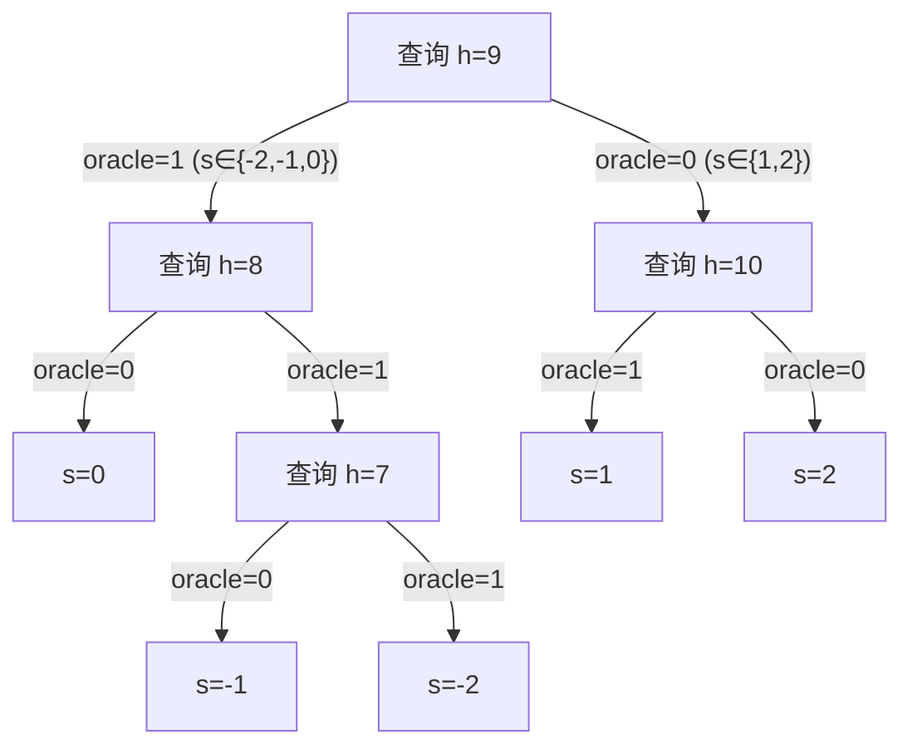

# <span style="color: rgb(25, 60, 71);"><span style="background-color: rgb(238, 249, 253);">(2021) A Systematic Approach and Analysis of Key Mismatch Attacks on Lattice-Based NIST Candidate KEMs</span></span>

| <!-- --> |
| ------------------------------------------------------------------------------------------------------------------------------------------------------------------------------------------------------------------------------------------------------------------------------------------------------------------------------------------------------------------------------------------------------------------------------------------------------------------------------------------------------------------------------------------------------------------------------------------------------------------------------------------------------------------------------------------------------------------------------------------------------------------------------------------------------------------------------------------------------------------------------------------------------------------------------------------------------------------------------------------------------------------------------------------------------------------------------------------------------------------------------------------------------------------------------------------------------------------------------------------------------------------------------------------------------------------------------------------------------------------------------------------------------------------------------------------------------------------------------------------------------------------------------------------------------------------------------------------------------ |
| **<span style="color: rgb(25, 60, 71);"><span style="background-color: rgb(219, 238, 221);">Author:</span></span>**<span style="color: rgb(25, 60, 71);"><span style="background-color: rgb(219, 238, 221);"> Mehdi Tibouchi; Huaxiong Wang; Yue Qin; Chi Cheng; Xiaohan Zhang; Yanbin Pan; Lei Hu; Jintai Ding;</span></span>                                                                                                                                                                                                                                                                                                                                                                                                                                                                                                                                                                                                                                                                                                                                                                                                                                                                                                                                                                                                                                                                                                                                                                                                                                                                         |
| **<span style="color: rgb(25, 60, 71);"><span style="background-color: rgb(243, 250, 244);">Journal: </span></span><span style="color: rgb(255, 0, 0);"><span style="background-color: rgb(243, 250, 244);">, </span></span><span style="color: rgb(25, 60, 71);"><span style="background-color: rgb(243, 250, 244);">13093: 92-121, 2021.</span></span>**                                                                                                                                                                                                                                                                                                                                                                                                                                                                                                                                                                                                                                                                                                                                                                                                                                                                                                                                                                                                                                                                                                                                                                                                                                             |
| **<span style="color: rgb(25, 60, 71);"><span style="background-color: rgb(219, 238, 221);">Journal Tags:</span></span>**                                                                                                                                                                                                                                                                                                                                                                                                                                                                                                                                                                                                                                                                                                                                                                                                                                                                                                                                                                                                                                                                                                                                                                                                                                                                                                                                                                                                                                                                              |
| **<span style="color: rgb(25, 60, 71);"><span style="background-color: rgb(243, 250, 244);">Local Link: </span></span>**<span style="color: rgb(25, 60, 71);"><span style="background-color: rgb(243, 250, 244);"><a href="zotero://open-pdf/0_5GR33G54" rel="noopener noreferrer nofollow">Qin 等 - 2021 - A Systematic Approach and Analysis of Key Mismatch Attacks on Lattice-Based NIST Candidate KEMs.pdf</a></span></span>                                                                                                                                                                                                                                                                                                                                                                                                                                                                                                                                                                                                                                                                                                                                                                                                                                                                                                                                                                                                                                                                                                                                                                       |
| **<span style="color: rgb(25, 60, 71);"><span style="background-color: rgb(219, 238, 221);">DOI: </span></span>**<span style="color: rgb(25, 60, 71);"><span style="background-color: rgb(219, 238, 221);"><a href="https://doi.org/10.1007/978-3-030-92068-5_4" rel="noopener noreferrer nofollow">10.1007/978-3-030-92068-5_4</a></span></span>                                                                                                                                                                                                                                                                                                                                                                                                                                                                                                                                                                                                                                                                                                                                                                                                                                                                                                                                                                                                                                                                                                                                                                                                                                                      |
| **<span style="color: rgb(25, 60, 71);"><span style="background-color: rgb(243, 250, 244);">Abstract: </span></span>***<span style="color: rgb(25, 60, 71);"><span style="background-color: rgb(243, 250, 244);">Research on key mismatch attacks against lattice-based KEMs is an important part of the cryptographic assessment of the ongoing NIST standardization of post-quantum cryptography. There have been a number of these attacks to date. However, a unified method to evaluate these KEMs’ resilience under key mismatch attacks is still missing. Since the key index of efficiency is the number of queries needed to successfully mount such an attack, in this paper, we propose and develop a systematic approach to find lower bounds on the minimum average number of queries needed for such attacks. Our basic idea is to transform the problem of finding the lower bound of queries into finding an optimal binary recovery tree (BRT), where the computations of the lower bounds become essentially the computations of a certain Shannon entropy. The optimal BRT approach also enables us to understand why, for some lattice-based NIST candidate KEMs, there is a big gap between the theoretical bounds and bounds observed in practical attacks, in terms of the number of queries needed. This further leads us to propose a generic improvement method for these existing attacks, which are confirmed by our experiments. Moreover, our proposed method could be directly used to improve the side-channel attacks against CCA-secure NIST candidate KEMs.</span></span>* |
| **<span style="color: rgb(25, 60, 71);"><span style="background-color: rgb(219, 238, 221);">Tags:</span></span>**                                                                                                                                                                                                                                                                                                                                                                                                                                                                                                                                                                                                                                                                                                                                                                                                                                                                                                                                                                                                                                                                                                                                                                                                                                                                                                                                                                                                                                                                                      |
| **<span style="color: rgb(25, 60, 71);"><span style="background-color: rgb(243, 250, 244);">Note Date: </span></span>**<span style="color: rgb(25, 60, 71);"><span style="background-color: rgb(243, 250, 244);">2026/8/3 11:59:33</span></span>                                                                                                                                                                                                                                                                                                                                                                                                                                                                                                                                                                                                                                                                                                                                                                                                                                                                                                                                                                                                                                                                                                                                                                                                                                                                                                                                                       |


## <span style="color: rgb(224, 255, 255);"><span style="background-color: rgb(102, 205, 170);">📜 Research Core</span></span>

*   摘要指出作者给出一种系统性方法寻找此类(miss match)攻击的查询下界,基本思想为将找下界问题转化成寻找优化BRT.

***


## Contributions:

*   一种统一的、系统性的方法寻找所有基于格的NIST候选密钥封装机制。
*   理论与实际破解所需的查询数量的巨大差异(NewHope,FrodoKEM,Saber),引入的optimal BRT方法使得能够理解这里巨大差异的成因,推进实际攻击选择更恰当的参数。
*   所改进的方案可直接用于进一步优化侧信道攻击NIST候选的CCA-Secure KEM的效率。
*   私钥中的系数范围、出现频率以及所用的编码与解码方法是最重要的评估密钥重用可靠性的三大因素。

### ⚙️ Content

*   full re-encryption在FO变换中往往解封装的主要开销。

*   key reuse:同一密钥用于加密多个独立加密过程、会话或信息,在一次一密中这回造成明文信息的泄露:

    $$
    C_1 = M_1 \oplus K_1\\
    C_2 = M2 \oplus K_2
    $$

当$K_1 = K_2$时,有$C_1 \oplus C_2 = M_1 \oplus M_2$.对称密码(如AES)中密钥重用一般不会造成问题,但是结合工作模式(如ECB)就可能会泄露信息。

*   mismatch:加密方与解密方使用的密钥不同,导致解密失败;mismatch attack 即利用解密成功or失败的信息来构造攻击(类似decryption failure oracle?)

#### CPA-secure LWE

*   Encode and Decode:不是必须步骤,但是通常都会采用：
  
    *   Encode过程即将m的每一比特按是1就分配 $\frac{q-1}{2}$ ,是0就分配0并重复 $v$ 遍,得到 $k$ 的一行,如此将 $\lambda$ 长的 $m$ 结合重复次数 $v$ 得到编码后的矩阵 $k_{\lambda \times v}$

    *   Decode过程利用$k$的一行还原$m$的一个比特,利用$k$该行每一个与$\frac{q-1}{2}$的平均距离($\frac{\sum \text{distance}}{v}$)与$\frac{q}{4}$$\frac{}{}$作比较决定$m$这一比特是0还是1.

*   这里Encode与Decde的一个好处是<span style="color: rgb(15, 17, 21);"><span style="background-color: rgb(255, 255, 255);">利用了</span></span>**<span style="color: rgb(15, 17, 21);"><span style="background-color: rgb(255, 255, 255);">重复冗余</span></span>**<span style="color: rgb(15, 17, 21);"><span style="background-color: rgb(255, 255, 255);">来对抗传输过程中的噪声干扰,传输过程中即使</span></span> $k$ <span style="color: rgb(15, 17, 21);"><span style="background-color: rgb(255, 255, 255);">某一行的几个位置出现错误,只要整体平均距离不出现大的偏差就依然能恢复正确的</span></span> $m$ 。

#### mismatch attack

*   攻击者  $\mathcal{A}$ 借助Oracle  $\mathcal{O}$ 的帮助实施,这里 $\mathcal{O}$ 的作用是根据输入的公钥 $P_B$ 、密文 $\bar c$ 以及秘密信息 $K_B$ ,自行利用 $P_B、\bar c$ 解密得到真正的秘密信息 $K_A$ ,判断 $K_A$ 与$K_B$是否相等,相等则返回1,否则返回0.

*   $\mathcal{A}$ 每次恢复私钥 $s_A$ 的一个系数或多个系数,统一称为一次恢复一块系数,令 $S = \{S_0,S_1,\cdots,S_{n-1}\}$ 为每一块的可能值,比如Kyber私钥的每一个系数都是取自中心二项分布,对其每次恢复一个系数,则 $S = \{-2,-1,0,1,2\}$ 。

*   假定每一个可能恰为真实要求系数块的概率为$P_i$,$\sum_{i=0}^{n-1}P_i = 1$.对于系数块$S_i$正确率为$P_i$,$\mathcal{A}$探测得到正确系数块所需要的查询次数为$Q_i$,则恢复一个系数块的平均(亦即期望)查询次数为:

    $$
    E_{\mathcal{A}}(S) = \sum_{i=0}^{n-1}P_i Q_i
    $$

    目标即最小化该平均查询次数。

#### Binary recovery tree

*   BRT是这样的一棵树,将 $S = \{S_0,S_1.\cdots,S_{n-1}\}$ 中每个(可能的系数块)作为叶子节点挂在有根二叉树上,左子节点编号1,右子节点编号0.

*   注意到 $\mathcal{A}$ 为了破解密钥时查询Oracle  $\mathcal{O}$ ,每次查询结果是一位0或1，经多次查询得到序列 $\bar s_i$ 且该串的查询可以得到正确的系数块 $S_i$ 。也就是说每一个系数块 $S_i$ 可以被一个唯一的查询序列 $\bar s_i$ 恢复，且对于不同的系数块 $S_i,S_j(i \neq j)$ ，分别对应的查询串 $\bar s_i,\bar s_j$ ,一定有 $\bar s_i$ 不是 $\bar s_j$ 的前缀，否则查询串就无法唯一恢复系数块 $S_i$ 了。

*   根据上面可以看到每个查询串对应一次恢复系数块查询Oracle $\mathcal{O}$的过程,因此查询串长度对应查询次数，在BRT中查询串长度即从根到叶子的深度，因此原来的平均查询次数可变为如下:

    $$
    E_{\mathcal{A}}(S) = \sum_{i=0}^{n-1}P_iQ_i = \sum_{i=0}^{n-1}P_i \cdot \text{depth}_{T_{\mathcal{A}}}(S_i)
    $$

    这里将平均查询次数变为BRT的WPL(weighted Path Length)了，问题从寻找最优$E_{\mathcal{A}}(S)$下界变为寻找二叉恢复树的最小:

    $$
    E(S) = \sum_{i=0}^{n-1}P_i \cdot \text{depth}_T(S_i)
    $$

*   使用Huffman coding可以有效构建具有最小WPL的BRT,一般采取维护堆的方式构建 Huffman tree(时间复杂度为 $O(n \log n)$ )。

*   于是对于这里各类基于格的算法,都可以通过基于每个系数块的所有可能，将它们构建出Haffman Tree,并计算$E(S)$，这样得到的$E(S)$就是mismatch attack破解一个系数块的平均查询下界,基于此就可以算出恢复整个密钥$sk$的平均最小查询下界了。

#### Imporved practical attack on Kyber

*   $\mathcal{A}$(假设现在要恢复私钥$s_A[0]$)借助Oracle,输入$P_B,(c_1,c_2),K_B$,其中:

    $$
    \begin{cases}
    m = (1,0,\cdots,0)\\
    P_B = (\lceil \frac{q}{32} \rfloor,0,\cdots,0)\\
    c_1 = \mathbf{Compress_q}(P_B,2^{d_{P_B}})\\
    c_2 = (h,0,\cdots,0)
    \end{cases}
    $$

    这里以kyber1024为例(出现32).

*   Oracle计算$u_A = \mathbf{Decompress_q}(c_1，2^{d_{P_B}})$,$v_A = \mathbf{Decompress_q(c_2,2^{d_{v_B}})}$,由上面选择的输入参数可以知道:

    $$
    \begin{cases}
    v_A[0] = \mathbf{Decompress}_q(c_2[0],1) = \lceil \frac{q}{32}h \rfloor\\
    u_A[0] = P_B[0] = \lceil \frac{q}{32} \rfloor
    \end{cases}
    $$

    因此Oracle解出来的明文(会进一步用于计算秘密信息$K$)第一比特为:

$$
    \begin{aligned}
    m'[0] &= \mathbf{Compress}_q((v_A - s_A^Tu_A)[0],1)\\
    	  &= \lceil \frac{2}{q}(v_A[0] - (s_A^Tu_A)[0]) \rfloor \mod 2 \\
          &= \lceil \frac{2}{q}(\lceil \frac{q}{32}h \rfloor - s_A^T[0]\lceil \frac{q}{32}\rfloor) \rfloor \mod 2 
    \end{aligned}
$$

*   这里令$h = 8$,可以得到,

    *   如果$s_A^T[0] \in [-2,-1]$(用-1具体计算),则有

        $$
        \begin{aligned}
        m'[0] &= \lceil\frac{2}{q} (\lceil \frac{q}{32} \times 8 \rfloor + \lceil \frac{q}{32} \rfloor)\rfloor mod 2\\
        &= \lceil \frac{2}{q} \times \frac{9}{32}q \rfloor \mod 2\\
        &= \lceil \frac{9}{16} (> 0.5) \rfloor \mod 2\\
        & = 1
        \end{aligned}
        $$

    *   同上带入计算，如果 $s_A^T[0] \in [0,2]$ ,则有 $m'[0] = 0$ 。

    因此,恰当地选择$h$,一次查询就能确定$s_A^T$的第一位属于哪个小区间(甚至具体确定是多少)。

*   当要计算$s_A[j]$时，上述参数几乎不用改变，只需要将$P_B$变为$P_B = \mathbf{0}$,除了$P_B[N-j] = -\lceil \frac{q}{32} \rfloor$,原因如下:

    *   关键是计算式子 $v - s_A \cdot u_A$  ,其中 $v \approx c_2$ , $u_A \approx c_1 = P_B$ .

    *   对于计算多项式乘法$s_A \cdot P_B$的常数项$(s_A \cdot P_B)[0]$(即$s_A \cdot u_A[0]$,在$m'[0]$中有该项),将$s_A(x) = \sum_{k=0}^{N-1} s_A[k] x^k$与构造的$P_B(x)$相乘:

        *   当$j = 0$时:$P_B(x) = C \cdot x^0$:

            $$
            (s_A \cdot P_B)(x) = s_A[0] \cdot C + \sum_{k=1}^{N-1} s_A[k] \cdot C \cdot x^k
            $$

            常数项为:

            $$
            (s_A \cdot P_B)[0] = s_A[0] \cdot C
            $$

        *   当$j > 0$,$P_B(x) = -C \cdot x^{N-j}$(这里$C = \lceil \frac{q}{32} \rfloor$):

            $$
            (s_A \cdot P_B)(x) = \sum_{k=0}^{N-1} s_A[k] x^k \cdot \left(-C x^{N-j}\right) = -C \sum_{k=0}^{N-1} s_A[k] x^{k + N - j}
            $$

        *   要找出上述展开式中结果为常数的项(即指数为0或$N$):

            $$
            C \cdot s_A[j] \cdot x^N \equiv -C \cdot s_A[j] \cdot (-1) \cdot x^0 = \mathbf{s_A[j] \cdot C \cdot x^0}
            $$

        *   对于其他 $k \neq j$ ，指数 $k + N - j \neq N$ ，且在 $[0, 2N-2]$ 范围内不为0，因此不会落入 $x^0$ 项,将常数结果提出来后依然是：

$$
(s_A \cdot P_B)[0] = s_A[j] \cdot C
$$

综上,对于恢复$s_A[j]$,当$j = 0$时令$P_B = (\lceil \frac{q}{32}\rfloor,0,\cdots,0)$;当$j \neq 0$时,令$P_B = \mathbf{0}$,<span style="color: rgb(255, 32, 32);">except</span>$P_B[N-j] = -\lceil \frac{q}{32}\rfloor$。

### 💡 Innovations

*   原本上述方法需要Oracle,但对于大多数实际部署的密码算法,会借助如FO变换使原来的CPA-secure变为CCA-secure版本，也就是说无法使用Oracle(因为不论是否match,都有返回结果)。但借助SCA信息可以绕过FO变换的限制，获得解密时是否匹配的信息。
*   大幅优化了Ravi et al.’s的攻击效率,将原来对Kyber512攻击所需的2560降低到1182.71(53.79%)。

### 🧩 Shortcomings

*   实际攻击中难以构造达到理论最短查询次数的参数设置,这是具体的密码方案导致的。比如Kyber1024中的BRT要求的第一次查询能将 $s_A[0]$ 区分成 $\{0,1\}$ 和 $\{-1,2,-2\}$ 的两部分，然而实际的第一次查询只能将 $s_A[0]$ 区分成 $\{-2,-1\}$ 和 $\{0,1,2\}$ 或 $\{-2,-1,0\}$ 和 $\{1,2\}$ 的两部分。

## <span style="color: rgb(32, 178, 170);"><span style="background-color: rgb(175, 238, 238);">🔁 Research Content</span></span>

***


### 🔬 Experiment

*   正文以Kyber1024为例，其中私钥 $s_A$ 规模为 $256 \times 4$ ,具体算法描述如下:


其中根据算法描述指出需要进行4轮(round = 4)恢复，每轮均需恢复256个系数块(这里就是$s_A$某行的一位)，恢复(recovers)即按照前面给出的The choice of h and the States表。

*   实验中生成1000个不同的$s_A$并分别恢复它们用于测试，实验结果如下图:
  

#### Code
  * 由于正文中是以Kyber1024为例子描述细节的，这里重点分析针对Kyber1024攻击的代码：
  ```c
/* the adversary chooses the ct */
/* input  : m, h, k, select
/*  output : c 
*/
  void enc(unsigned char * c, 
         const unsigned char * m, 
         int h, int k, int select)
{
  polyvec Pb = { .vec[0] = {0} };  //init Pb = 0
  poly v = { .coeffs = {0} };      //init v = 0

  poly r;
  poly_frommsg(&r, m);

  /*  set 
   *  Pb[0]    = rounding(q/32)  when  k  = 0
   *  P[256-k] = rounding(q/32)  when  k != 0      
   */
  k == 0 ? (Pb.vec[select].coeffs[0] = (int)(KYBER_Q/32.0 + 0.5)) 
         : (Pb.vec[select].coeffs[256-k] = (int)(-(KYBER_Q/32.0 + 0.5)));

  polyvec_reduce(&Pb);  // compress(Pb) = c1
  v.coeffs[0] = h;      // set c2[0] = h

  pack_ciphertext_Attack(c, &Pb, &v);    // pack all c
}
  ```
这里重点是根据攻击行select和具体第k位来确定pb的某一位为特定数(k=0即第位为$\lceil \frac{q}{32}\rfloor$;k不为0,则为第$256-k$位为$-\lceil \frac{q}{32}\rfloor$,代码中+0.5然后取整等同于这里取最近的整数)，其他位为0.值得注意的是,这里因为Kyber1024解压缩的参数$d_v = 5$,所以是$\frac{q}{2^5}$,而Kyber768和Kyber512解压缩参数$d_v = 4$,因此是$\frac{q}{2^4} = \frac{q}{16}$,具体参看Kyber768、Kyber512的代码如下:
```c
void enc(unsigned char * c, 
         const unsigned char * m, 
         int h, int k, int select)
{
  polyvec Pb = { .vec[0] = {0} };  //init Pb = 0
  poly v = { .coeffs = {0} };      //init v = 0

  poly r;
  poly_frommsg(&r, m);

  /*  set 
   *  Pb[0]    = rounding(q/32)  when  k  = 0   <-官方代码注释这里不对,但是下面实现的地方是对的
   *  P[256-k] = rounding(q/32)  when  k != 0   <-
   */
  k == 0 ? (Pb.vec[select].coeffs[0] = (int)(KYBER_Q/16.0 + 0.5)) 
         : (Pb.vec[select].coeffs[256-k] = (int)(-(KYBER_Q/16.0 + 0.5)));//<-这里的确是KYBER_Q/16
  polyvec_reduce(&Pb);           // compress(Pb) = c1
  v.coeffs[0] = h;               // c2[0] = h

  pack_ciphertext_Attack(c, &Pb, &v);   // pack all c
}
```


```c
int oracle(const unsigned char * ct, 
           const unsigned char * sk, 
           unsigned char * msg_A) 
{

  unsigned char m_dec[KYBER_SYMBYTES] = { 0 };
  

  indcpa_dec(m_dec, ct, sk);     //decrypt the ct
  /* check msg_A given by adversary ==  the m_dec decrypted by oracle */
  for(int a = 0; a < KYBER_SYMBYTES; a++) {
    if(msg_A[a] != m_dec[a]){
      //printf("a:%d miss:%d %d\n", a, msg_A[a], m_dec[a]);
      return 0;
    }
  }
  
  return 1;
}
```

```c
static int htable[5][2] = {{9, 0}, {10, 1}, {8, -1}, {11, 2}, {7, -2}};


/* check h to get corresponding s */ 
static int checkh(int h) {
    for(int i = 0; i < 5; i++) {
        if(htable[i][0] == h)
            return htable[i][1];
    }
    return 99;    //fail check
}
```
这里是构建h->s的映射表和检查函数,表的由来即论文中描述的kyber1024的The choice of h andThe States表。具体来说,对于$\lceil \frac{q}{32} \rfloor \times h$的结果:
| h | result |
| --- | --- |
| 7 | 728 |
| 8 | 832 |
| 9 | 936 |
| 10 | 1040 |
| 11 | 1144 |

下面计算结果为当$s_A[j]$为横坐标的某一个、$h$为纵坐标的某一个时$m'[0]$是否大于0的表:
| s \ h | 7 (728) | 8 (832) | 9 (936) | 10 (1040) | 11 (1144) |
| --- | --- | --- | --- | --- | --- |
| −2 | 728+208=936✓ | 832+208=1040✓ | 1144✓ | 1248✓ | 1352✓ |
| −1 | 728+104=832✗ | 832+104=936✓ | 1040✓ | 1144✓ | 1248✓ |
| 0 | 728✗ | 832✗ | 936✓ | 1040✓ | 1144✓ |
| +1 | 624✗ | 728✗ | 832✗ | 936✓ | 1040✓ |
| +2 | 520✗ | 624✗ | 728✗ | 832✗ | 936✓ |

可以看到，表中记录的映射是密钥系数每一种可能下，首次解压缩结果为1时的$h$(二维矩阵中实际是$h$在前，$s_A[j]$在后)。

这里构建Oracle,过程中使用了正确密钥sk和解密函数indcpa_dec(),用于解密得到真正的信息m_dec,用来与输入的msg_A比较,匹配成功则返回1,否则返回0。构建映射表htable、check()函数以及后续优化的参数选择攻击过程就与上面的表有关(具体见下面代码分析)。

```c
#define OPTIMIZATION       // uncomment this to get the version without optimization
#ifndef OPTIMIZATION
    /*  no optimization */
    /* loop h to recover s */
    for(int i = 0; i < KYBER_K; i++) {
        for(int k = 0; k < KYBER_N; k++) {
            for(h = 0; h < 32; h++) {
                kemenc_Attack(ct, m, pk, h, k, i);  // choose appropriate ct
                query += 1;    // count queries                     
                if(oracle(ct, sk, m) == 1) {        // send ct to oracle 
                    break;
                }
            }
            recs[i][k] = checkh(h);                 // check the value of h to get s
        }
    }
```
上述代码这里是Kyber_Attack()中的部分(非优化版本)关键代码,展示的是在非优化情况下暴力搜索h的共32种可能，之所以是32则是因为$c_2$经过$\text{compress}$操作后每一位都压缩成$5$bit即共$2^5 = 32$种可能。停止条件是遍历时首次出现Oracle返回1，此时根据上面的htable表就能确定$s_A[j]$。

```c
#else
    /*  optimization */
    for(int i = 0; i < KYBER_K; i++) {
        for(int k = 0; k < KYBER_N; k++) {
            kemenc_Attack(ct, m, pk, 9, k, i);     // set h = 9
            if(oracle(ct, sk, m) == 1) {
                query += 1;
                kemenc_Attack(ct, m, pk, 8, k, i); // set h = 8
                if(oracle(ct, sk, m) == 0) {
                    recs[i][k] = 0;
                    query += 1;
                }
                else {
                    query += 1;
                    kemenc_Attack(ct, m, pk, 7, k, i); // set h = 7
                    if(oracle(ct, sk, m) == 0) {
                        recs[i][k] = -1;
                        query += 1;
                    }
                    else {
                        recs[i][k] = -2;
                        query += 1;
                    }   
                }
            }
            else {
                query += 1;
                kemenc_Attack(ct, m, pk, 10, k, i);   //  set h = 10
                if(oracle(ct, sk, m) == 1) {
                    recs[i][k] = 1;
                    query += 1;
                }
                else {
                    recs[i][k] = 2;
                    query += 1; 
                }
            }
        }
    }
#endif
```
上述代码则是根据本论文提出的BRT构建的代码,不再盲目搜索h,而是根据Oracle的返回结果来确定h的取值以及$s_A[j]$的结果。
具体而言，对每对 (i, k):

上述的状态转移与代码一致。

```c
    int checks = 0;
    for(int i = 0; i < KYBER_K; i++) {
        for(int j = 0; j < KYBER_N; j++) {
            if(recs[i][j] != skpoly.vec[i].coeffs[j]) {
                checks++;
                printf("error s in s[%d][%d] ", i, j);
            }
        }   
    }
    
    /* print the queries */
    if(checks == 0)
        printf("fact queries: %d\n", query);
    else 
        printf("not correct\n");
    return query;
```
这里是最后检查攻击结果是否正确。

代码编译后运行结果如上图，可以看到未优化版本的查询次数是10185，优化版本的查询次数是2402，4倍以上的差距，足见优化的有效性。


### 📜 Conclusion

*   本文指出一种统一方法计算使用mismatch攻击基于格的NIST候选KEMs算法的最小查询下界(即最优BRT)。构建最优BRT同样能用于指导优化实际攻击时的参数选取。

*   基于上述构建最优BRT过程可以总结出影响这里最小查询下界的三大因素分别为:

    *   参数范围 (如Kyber512的 $s_A$ 每一个系数的 范围是 $[-3,3]$ ,Kyber768/1024范围是 $[-2,2]$ )。
    *   每一种可能参数出现的概率 (这在计算 $E_{\mathcal{A}}(S)$ 时会有体现,所谓参数出现概率,如上述Kyber512的 $s_A$ 的每一位出现 $0$ 的概率会大于 $\pm 1$ ,事实上出现每一位的概率都是可以计算的，当然这里算出来的是理论概率)。
    *   是否使用Encode/Decode (使用Encode/Decode可以使得一次恢复多个系数)。

## <span style="color: rgb(0, 77, 153);"><span style="background-color: rgb(135, 206, 250);">🤔 Personal Summary</span></span>


### 🙋♀️ Key Records

*   本文给出系统性评价(计算出)使用mismatch 攻击基于格的NIST候选KEMs算法的最小查询下界，将求最小 $E_{\mathcal A}(S)$ 转换到求最优BRT的WLP上，该BRT可利用Huffman coding(时间复杂度为 $O(n \log n)$ )有效构建,进而可有效计算该下界。

*   构建BRT的过程可用于优化实际攻击时的参数选取。即对于某一分叉的地方，选取参数使得Oracle返回0或1的不同结果可以将待求系数块分成原来更大可能集合的子集。然后不断改变参数使得可能结果范围不断减小，最终高效确定系数块的具体值。

*   但是由于有时无法选出参数使得能将待求系数块分成BRT中要求的(理想)子集(见Shortmings)，所以实际攻击时的所需查询次数会与理论有出入。

*   mismatch攻击需要用到Oracle $\mathcal O$，但现实使用的KEMs往往结合如FO变换，是CCA安全的，按理来说并不存在mismatch 攻击所需要的Oracle 。此时结合SCA，通过构建Decapsulation时结果为匹配和不匹配时的两套template(这两套template是不一样、可区分的)，实际攻击时收集到的trace与template求平方差，差异更大的说明此时结果为另一种，这也就实现了Oracle的功能。也就是说,**借助SCA可以绕过FO变换限制,构造出可用的Oracle**。

